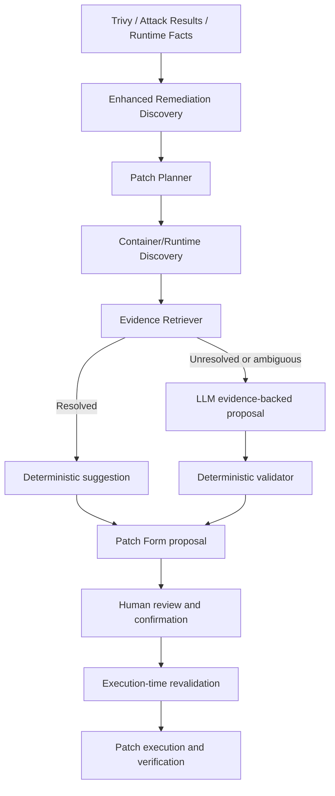

# Patch Form: Discovery, LLM Suggestion, and Human Confirmation Scope

## สถานะเอกสาร

เอกสารนี้กำหนด **ขอบเขตเป้าหมาย (target policy)** สำหรับ LLM Patch Assistance
โดยแยกบทบาทของ Enhanced Remediation Discovery, Patch Planner,
Container/Runtime Discovery, Evidence Retriever, LLM, มนุษย์ และ Verification Pipeline
ออกจากกันอย่างชัดเจน

ข้อกำหนดสำคัญ:

- LLM ให้ได้เฉพาะ **ข้อเสนอ (`suggested` หรือ `alternatives`)** พร้อมหลักฐานอ้างอิง
- LLM ห้ามเขียน `confirmed`, ห้ามสร้าง human confirmation และห้าม submit Patch Form
- มนุษย์เป็นผู้ตรวจสอบและยืนยัน Patch Configuration ขั้นสุดท้ายเสมอ
- Discovery, Planner และ validator ต้องทำงานแบบ deterministic และเป็น authority
  ในการรับหรือปฏิเสธข้อเสนอ
- Human confirmation ไม่สามารถข้าม deterministic validation, execution-time revalidation
  หรือ safety gates
- LLM failure หรือหลักฐานไม่พอต้องปล่อย field เป็น `PARTIAL`, `UNRESOLVED` หรือ
  `INSUFFICIENT_EVIDENCE` ห้ามเดาค่า
- Verification Pipeline เป็นผู้พิสูจน์ผลการแก้ไข ไม่ใช่ LLM
- ขอบเขตเป้าหมายนี้ไม่ใช่คำอธิบาย capability ปัจจุบันทั้งหมด ดูหัวข้อ
  [ความต่างจาก implementation ปัจจุบัน](#ความต่างจาก-implementation-ปัจจุบัน)

## ลำดับการตัดสินใจ

ใช้ลำดับต่อไปนี้กับทุก Patch Action:

1. Enhanced Remediation Discovery อ่าน scanner evidence, vendor evidence, artifact/source
   metadata และ validated knowledge เพื่อสร้าง remediation candidates พร้อม provenance
2. Patch Planner จัดกลุ่ม CVE ตาม package สร้าง deterministic suggestions ระบุ unresolved
   fields และตรวจ executor capabilities
3. Container/Runtime Discovery ค้นหาตำแหน่งและสภาพจริงของ component เป้าหมายเมื่อ
   Patch Action ต้องใช้ข้อมูล runtime/application layout
4. Evidence Retriever รวมเฉพาะ evidence ที่ผูกกับ run, action, candidate, image และ plan
   revision เดียวกัน
5. ถ้ามีคำตอบเดียวที่พิสูจน์ได้และ policy อนุญาต ให้ระบบใช้ deterministic suggestion โดยตรง
6. ถ้ายังมีหลายตัวเลือก ข้อมูลขัดแย้ง หรือจำเป็นต้องตีความ evidence จึงให้ LLM เสนอค่า
   หรือ alternative
7. Deterministic validator ตรวจ schema, evidence binding, artifact state, executor
   compatibility และ command policy
8. ข้อเสนอที่ผ่าน validator ถูกแสดงใน Patch Form โดยยังไม่เป็น `confirmed`
9. มนุษย์ตรวจ evidence และเลือกหรือกรอกค่า `confirmed`
10. ก่อน execute ระบบตรวจ plan, image, artifact, runtime evidence และ safety gates ซ้ำ
11. Validation command, after-scan, re-exploit และ final evaluation เป็นผู้ตรวจผลหลัง patch



## Enhanced Remediation Discovery

Enhanced Remediation Discovery ตอบว่า **ต้องแก้อะไร มีวิธีแก้อะไร และมี artifact/source
candidate ใดให้ใช้** โดยไม่สร้าง shell command

ข้อมูลเป้าหมาย:

- CVE, package/component, ecosystem และ PURL
- installed version และ fixed-version candidates
- scanner target และ package metadata ที่ Trivy รายงาน
- vendor advisory และ upgrade guidance
- official artifact และ source candidates
- source authority, availability, integrity และ provenance
- Fix Type และ Patch Strategy suggestions
- ambiguity, conflicting evidence และ missing evidence

สถานะ artifact ต้องแยกกัน ไม่ใช้คำว่า verified เพียงสถานะเดียว:

```text
SOURCE_DISCOVERED
SOURCE_AUTHORITY_VERIFIED
VERSION_AVAILABLE
ARTIFACT_DOWNLOADED
CHECKSUM_VERIFIED
```

ข้อกำหนด:

- การพบ URL ไม่ทำให้ artifact เป็น trusted โดยอัตโนมัติ
- `checksum` ที่ใช้ execute ต้องมาจาก trusted manifest หรือคำนวณจาก artifact bytes
  ด้วย deterministic code
- Scanner target/path ต้องไม่ถูกตีความเป็น runtime replacement path โดยไม่มีหลักฐานเพิ่ม
- การไม่พบ `pom.xml` หรือ local manifest ไม่เพียงพอที่จะยืนยัน Fix Type B หรือ
  `PREBUILT_IMAGE_REPLACEMENT`
- หากวิธีติดตั้งหรือ build ยังไม่พิสูจน์ ให้ classification เป็น `PARTIAL` หรือ `UNRESOLVED`
- ทุก candidate ต้องมี provenance และข้อจำกัดที่ตรวจสอบได้

## Patch Planner

Patch Planner ยังคงทำงานแบบ rule-based:

- เลือก CVE ที่เป็น remediation target
- จัดกลุ่ม CVE ตาม package/component
- สร้างหนึ่งหรือหลาย Patch Actions
- สร้าง deterministic suggestions
- ระบุ unresolved fields และ input reasons
- ตรวจ capability และ preconditions ของ executor

Planner ต้องแยกสถานะต่อไปนี้ออกจากกัน:

- ข้อมูล Patch ครบหรือไม่
- มี executor รองรับ strategy หรือไม่
- preconditions ก่อน execution ครบหรือไม่
- action พร้อม execution จริงหรือไม่

Executor capability ต้องมาจาก backend/configuration ที่ระบบตรวจสอบได้ ไม่ใช่จาก LLM
หรือข้อความใน Patch Form ตัวอย่าง capability ปัจจุบัน:

| Strategy | Capability ปัจจุบัน | เงื่อนไขสำคัญ |
|---|---|---|
| `PACKAGE_MANAGER` | รองรับ | package, ecosystem และ target version ต้อง resolve ได้ |
| `HUMAN_COMMAND` | รองรับ | ต้องรันที่ `patch-workspace` และมี human-confirmed command |
| `PREBUILT_IMAGE_REPLACEMENT` | รองรับบางส่วน | ต้องเป็น local Docker image ที่ resolve ได้ |
| `IMAGE_REPLACEMENT` | รองรับบางส่วน | ต้องเป็น local image และตรวจ image ID |
| `REBUILD` | ยังไม่มี executor | ห้ามอ้างว่าพร้อม execute |
| `ARTIFACT_REPLACEMENT` | ยังไม่มี executor | ห้ามอ้างว่าพร้อม execute |
| `COPACETIC`, `MUTATION`, `DOCKER_COMMIT` | ยังไม่มี executor | ห้ามอ้างว่าพร้อม execute |

## Container/Runtime Discovery

Container/Runtime Discovery ตอบว่า **component เป้าหมายอยู่ที่ไหนและมีสภาพอย่างไร**
โดยเป็น deterministic system component ไม่ใช่การสำรวจที่ LLM สั่งเอง

Input:

- Patch Action
- package name, PURL, installed version และ ecosystem
- Trivy target/path และ scanner metadata
- source image identity
- running-container facts
- plan revision และ candidate binding

ข้อมูลที่ผลิต:

- exact component/package locations ที่พบ
- ตำแหน่งใน source image, running container และ inspection workspace
- archive เทียบกับ exploded deployment layout
- image-owned เทียบกับ runtime-generated files
- package/archive ownership
- mount, read-only และ writable state
- symlink และ file type ที่เกี่ยวข้อง
- provenance, ambiguity, completeness และ limitations

หลักการค้นหา:

- สร้าง deterministic search keys จาก package, PURL, version และ ecosystem
- เลือก bounded candidate roots จาก Trivy target, image metadata, entrypoint, process facts
  และ ecosystem-specific conventions
- ใช้ inspection profiles เช่น Java/Tomcat, OS package หรือ generic application
- ไม่ crawl filesystem ทั้ง container โดยไม่มีขอบเขต
- ไม่อ่าน file contents โดย default
- ไม่ใช้ network โดย default
- ไม่เก็บ secrets, credentials, token หรือ authorization data
- environment values ใช้ explicit allowlist และ redaction; default คือไม่เก็บค่า
- inspection commands มาจาก allowlisted system profiles ไม่ใช่ LLM
- ต้องแยก fact ที่พบใน running container ออกจาก fact ที่มีอยู่ใน patch workspace

Container/Runtime Discovery ไม่ทำสิ่งต่อไปนี้:

- ไม่สร้าง patch command หรือ validation command
- ไม่เลือก Fix Type หรือ Strategy แทน Planner/มนุษย์
- ไม่รับรอง artifact หรือ checksum
- ไม่เขียน `confirmed`
- ไม่อนุมัติ execution

Artifact เป้าหมายต้อง bind กับ run, action, image และ plan revision เช่น:

```yaml
schema: kalama.container-runtime-discovery/v1
run_id: example
action_id: patch-001
base_patch_plan_sha256: ...
source_image_id: sha256:...
inspection_profile: JAVA_TOMCAT
status: PARTIAL
locations: []
limitations: []
errors: []
```

สถานะที่รองรับควรแยกอย่างน้อย:

```text
COMPLETED
PARTIAL
NOT_APPLICABLE
UNRESOLVED
FAILED
```

## Evidence Retriever

Evidence Retriever เป็นตัวรวบรวมและคัดเลือก evidence ไม่ใช่ตัวสร้างข้อเท็จจริงใหม่
หรือ crawler filesystem

หน้าที่:

- รวม scanner/Trivy evidence
- รวม Enhanced Remediation Discovery evidence
- รวม Container/Runtime Discovery evidence
- รวม vendor/artifact evidence
- รวม compatible validated knowledge
- รวม executor capabilities
- เลือกเฉพาะ facts ที่เกี่ยวข้องกับ Patch Action และ field ที่กำลังพิจารณา
- รักษา provenance และ evidence references
- bind evidence กับ run, action, candidate, source image และ plan revision
- ไม่ส่ง secrets หรือข้อมูลที่ไม่เกี่ยวข้องให้ LLM

หาก evidence source ไม่มีข้อมูล ต้องรายงาน `NOT_APPLICABLE`, `UNAVAILABLE` หรือ
`INSUFFICIENT_EVIDENCE` ตามกรณี ห้ามสร้าง fallback fact ที่ไม่มี provenance

## ขอบเขต field ใน Patch Form

นโยบายเป้าหมายอนุญาตให้ LLM ช่วยเสนอ field ด้านล่าง แต่ทุกค่าต้องเป็น suggestion หรือ
alternative และต้องผ่าน deterministic validator ก่อนแสดงใน Patch Form

| Field | ระบบ deterministic ใช้โดยตรงได้เมื่อ | LLM ช่วยอย่างไรเมื่อยัง unresolved | ผู้ยืนยันสุดท้าย |
|---|---|---|---|
| `fix_type` | classification มีหลักฐานเดียวและไม่ขัดแย้ง | เปรียบเทียบ A/B/C จาก installation, source, artifact และ executor evidence | มนุษย์ |
| `target_version` | scanner/vendor ระบุ fixed version เดียวและ branch policy ผ่าน | เปรียบเทียบ fixed-version candidates โดยอ้าง vendor, branch และ compatibility evidence | มนุษย์ |
| `strategy` | มี strategy เดียวที่ evidence และ executor รองรับ | เสนอ strategy หรือ alternative ที่อยู่ใน supported vocabulary พร้อม preconditions | มนุษย์ |
| `artifact_source` | official source และ authority/availability ผ่าน policy | เสนอ source candidate จาก evidence pack ห้ามสร้าง URL ที่ไม่มี evidence | มนุษย์ |
| `source_identifier` | repository/artifact identity พิสูจน์ได้โดยตรง | เชื่อม package/PURL กับ candidate ที่ Discovery ให้มา | มนุษย์ |
| `build_system` | manifest และ source metadata ระบุชัดเจน | เสนอเฉพาะ build system ที่มีหลักฐานและ validator รองรับ | มนุษย์ |
| artifact destination | Container/Runtime Discovery พบตำแหน่งเดียวและ origin ชัด | เลือกจาก discovered locations เท่านั้น พร้อมอธิบาย archive/runtime implications | มนุษย์ |
| replacement image reference | image candidate และ identity พิสูจน์ได้ | เสนอเฉพาะ image candidate ที่ Discovery ให้มาและ executor รองรับ | มนุษย์ |
| `command` | มี validated command template ที่ bind กับ environment เดียวกัน | สร้าง proposal จาก artifact, location, runtime และ executor evidence; ห้าม execute | มนุษย์ |
| `validation_command` | มี validated verification template ที่ใช้กับ action เดียวกัน | เสนอการตรวจ state หลัง patch โดยต้องผ่าน command policy เช่นเดียวกับ `command` | มนุษย์ |
| `notes` | ระบบมีข้อจำกัดที่สรุปได้โดยตรง | อธิบายเหตุผล, assumptions, evidence gaps, risks และ limitations | มนุษย์ตรวจอ่าน |

`checksum` ไม่ใช่ field ที่ LLM มีสิทธิ์กำหนดเป็นค่าที่รับรองแล้ว LLM อาจชี้ว่า manifest
หรือ source ใดมี checksum และอธิบายว่าต้องตรวจอะไร แต่ค่าที่ใช้ execute ต้องมาจาก trusted
manifest หรือ deterministic calculation จาก artifact bytes

## Alternative Proposal

LLM สามารถเสนอทางเลือกที่ต่างจาก deterministic suggestion ได้ แต่ต้องไม่เขียนทับ
suggestion เดิม และต้องไม่เปลี่ยน confirmed value

```yaml
strategy:
  suggested: PREBUILT_IMAGE_REPLACEMENT
  alternatives:
    - value: HUMAN_COMMAND
      proposed_by: LLM
      evidence_refs:
        - container-runtime-location
        - vendor-guidance
      reason: Direct artifact replacement appears possible.
  confirmed: null
```

Alternative ทุกตัวต้อง:

- อยู่ใน typed vocabulary
- อ้างเฉพาะ evidence references ใน evidence pack
- ระบุ assumptions, preconditions และ limitations
- ผ่าน executor compatibility และ field-specific validation
- ไม่ overwrite deterministic suggestion
- ให้มนุษย์เป็นผู้เลือกและยืนยัน

## วิธีที่ LLM ต้องช่วย

ข้อเสนอ LLM ทุก field ต้องมีคุณสมบัติดังนี้:

- รับเฉพาะ evidence pack ของ run, Patch Action, component, candidate, image และ plan revision
  ที่กำลังพิจารณา
- ส่งกลับ typed value พร้อม `evidence_refs`, reason, assumptions และ limitations
- อ้างได้เฉพาะ reference ที่อยู่ใน evidence pack
- เลือก source, location, artifact หรือ image ได้เฉพาะ candidate ที่ระบบให้มา
- ตอบ `INSUFFICIENT_EVIDENCE` เมื่อหลักฐานไม่พอ
- ห้ามเขียนลง `confirmed` และห้ามเปลี่ยน field ที่ถูกยืนยันแล้ว
- ห้ามสร้าง trust, authority, checksum verification หรือ readiness
- ห้าม submit form, execute command หรือเริ่ม Patch Execution
- suggestion ต้องผ่าน deterministic validator ก่อนแสดงใน Patch Form

แนวทางรายกลุ่ม:

- **Remediation selection** (`fix_type`, `target_version`, `strategy`): เปรียบเทียบเฉพาะ
  candidates ที่มี evidence และระบุ incompatibility
- **Source binding** (`artifact_source`, `source_identifier`, `build_system`): เชื่อม package
  กับ official/validated candidates โดยไม่สร้าง source ใหม่
- **Replacement binding**: เลือกเฉพาะ discovered location/image candidates และคงความต่าง
  ระหว่าง artifact destination กับ replacement image reference
- **Command proposal**: ใช้เฉพาะ path, artifact, tools และ executor facts ที่ evidence ยืนยัน
- **Explanation** (`notes`): แยก observed, inferred และ unresolved assumptions อย่างชัดเจน

## ส่วนที่สงวนให้มนุษย์หรือระบบเท่านั้น

LLM ห้ามทำสิ่งต่อไปนี้:

- เขียน `confirmed` หรือ `human_confirmed_fields`
- เลือก `SKIP_OUT_OF_SCOPE` หรือกำหนด disposition/reason แทนมนุษย์
- อนุมัติ major-version change
- เปลี่ยน `execution_target`
- กำหนด source authority หรือ trusted state
- สร้างหรือรับรอง checksum
- ตั้ง action readiness/status
- อนุมัติ execution
- ยืนยันว่า remediation สำเร็จ
- สร้างหรือเลือกคำสั่งสำหรับ Container/Runtime Discovery

มนุษย์เป็นผู้เลือก Patch Configuration และยืนยันเจตนา แต่ confirmation ไม่อนุญาตให้ bypass
schema validation, evidence binding, artifact verification, executor constraints หรือ command policy

## Proposal Validation และ Execution-time Revalidation

ข้อเสนอ LLM ต้องผ่าน deterministic validation อย่างน้อยดังนี้:

- schema และ field whitelist
- run/action/candidate/plan binding
- evidence digest และ evidence references
- field type และ value constraints
- Fix Type/Strategy compatibility
- target-version branch constraints
- executor support และ preconditions
- artifact source/availability/integrity state
- Container/Runtime Discovery freshness และ source image identity
- artifact destination หรือ replacement image membership
- execution target
- command policy

ทั้ง `command` และ `validation_command` ต้องผ่าน command policy เพราะทั้งคู่รันผ่าน shell
และสามารถเปลี่ยน filesystem ได้ Static validation ไม่สามารถพิสูจน์ความปลอดภัยได้ทุกกรณี
จึงยังต้องมี human review, isolated patch workspace, execution-time revalidation และ post-patch
verification

ก่อน execute ระบบต้องตรวจซ้ำอย่างน้อย:

- Patch Plan revision และ submission lineage
- source image identity
- Runtime Discovery artifact freshness
- artifact availability และ checksum
- executor support
- required preconditions
- execution target
- command policy

## Patch Execution และ Verification

Patch Execution:

- รัน mutation command ใน `patch-workspace`
- เก็บ command digest, exit code และ execution evidence
- รัน `validation_command` หลัง Patch Command
- validation failure ต้องหยุดก่อน finalize/commit patched image
- LLM ไม่มีสิทธิ์เปลี่ยนผล execution

Verification Pipeline:

- ตรวจ patched image และ lineage
- รัน Trivy after-scan
- เปรียบเทียบ intended และ incidental CVEs
- ทำ re-exploit ตาม protocol ที่ระบบอนุญาต
- สร้าง final evaluation
- เขียน validated remediation knowledge เฉพาะผลที่ผ่าน verification policy

LLM ไม่มีสิทธิ์กำหนด `remediation_verified` หรือ final status

## ความต่างจาก implementation ปัจจุบัน

Production ปัจจุบันจำกัด LLM eligibility ไว้ที่:

```text
fix_type
strategy
target_version
artifact_source
source_identifier
build_system
notes
```

และ project ลง Patch Form ได้โดยตรงเฉพาะ suggested slots ของ:

```text
fix_type
strategy
target_version
artifact_source
```

`source_identifier`, `build_system` และ `notes` ยังอยู่ใน guidance sidecar เท่านั้น

Production ปัจจุบันยังไม่อนุญาตให้ LLM เสนอ:

- artifact destination หรือ replacement image reference
- `command`
- `validation_command`
- alternative proposals
- `checksum`

Container/Runtime Discovery artifact ตามเอกสารนี้ยังไม่ได้ implement และ Evidence Retriever
ปัจจุบันเน้นรวบรวม scanner/runtime facts และ compatible validated knowledge ที่มีอยู่แล้ว
Vendor/NVD retrieval ถูกปิดโดย default ใน production collector

Execution backend ปัจจุบันรองรับจริงเฉพาะ `PACKAGE_MANAGER`, `HUMAN_COMMAND` และ local
image replacement paths ตามข้อจำกัดที่ระบุไว้ข้างต้น Strategy ที่มีใน enum ไม่ได้หมายความว่า
มี executor พร้อมใช้งาน

ก่อนเปิด target fields เพิ่ม ต้องมี typed proposal schemas, field-specific evidence contracts,
validator rules, Patch Form projection/UI, executor capability gates, command policy และ tests ที่
พิสูจน์ว่า LLM ไม่สามารถสร้าง confirmation หรือข้าม safety boundary ได้

## ลำดับการพัฒนา

### ระยะที่ 1: Enhanced Discovery

- Raw Trivy enrichment
- vendor retrieval
- artifact/source discovery
- artifact verification states
- candidate evaluation และ provenance
- แก้ classification ที่ไม่มีหลักฐานให้เป็น `PARTIAL`/`UNRESOLVED`
- executor capability validation
- เชื่อม evidence ใหม่เข้า Evidence Retriever

เป้าหมายคือให้ Discovery สร้าง remediation candidates ได้ดีขึ้นแม้ปิด LLM

### ระยะที่ 2: Container/Runtime Discovery และ LLM Assistance

- deterministic inspection profiles
- bounded component-location discovery
- Container/Runtime Discovery artifact
- Evidence Retriever integration
- alternative proposal schema
- artifact destination และ replacement image proposals
- Patch command assistance
- validation command assistance
- deterministic command validation
- Patch Form/UI สำหรับ provenance, alternatives, risks และ unresolved assumptions
- human confirmation และ execution-time revalidation

### ระยะที่ 3: Advanced Automation

- dedicated `REBUILD` executor
- dedicated `ARTIFACT_REPLACEMENT` executor
- ecosystem-specific inspectors เพิ่มเติม
- automatic build planning
- advanced candidate ranking
- validated knowledge reuse ข้าม environment พร้อม compatibility checks

## Invariants ที่ห้ามเปลี่ยน

- LLM output เป็น suggestion/alternative ไม่ใช่ confirmation
- Human confirmation เกิดจาก Patch Form submission เท่านั้น
- Discovery, Planner และ validator เป็น authority ในการยอมรับหรือปฏิเสธ suggestion
- ค่า deterministic และค่าที่มนุษย์ยืนยันแล้วมีลำดับความสำคัญเหนือ LLM
- ไม่มี evidence ต้องเป็น `PARTIAL`, `UNRESOLVED` หรือ `INSUFFICIENT_EVIDENCE`
- LLM ห้ามสร้าง trust, checksum verification, readiness หรือ verification result
- การเสนอ `command` หรือ `validation_command` ไม่ได้ให้อำนาจ execute
- Container/Runtime Discovery ต้อง deterministic, bounded และไม่ถูกควบคุมด้วยคำสั่งจาก LLM
- Human confirmation ไม่ bypass deterministic safety gates
- Patch mutation ต้องรันใน `patch-workspace`
- การยืนยัน remediation สำเร็จต้องมาจาก Verification Pipeline เท่านั้น
